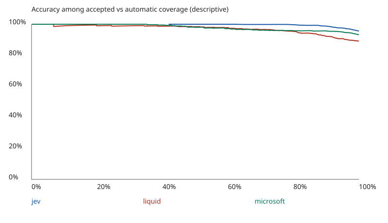

# Saved-response report

These curves are descriptive. Choose thresholds on development data and validate frozen rules on independent data.

| Model | Correct / total | Accuracy | Recorded cost USD |
|---|---:|---:|---:|
| jev | 955 / 1000 | 95.50% | 0.03290847 |
| liquid | 891 / 1000 | 89.10% | 0.00707416 |
| microsoft | 932 / 1000 | 93.20% | 0.012574422 |

CSV files contain exact values; `analysis.json` includes predicted-class metrics and error overlap.
